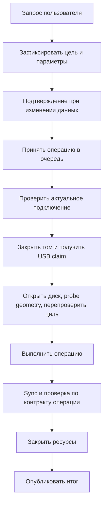

# Модель взаимодействия Android и USB-накопителя

**Статус:** фактическая политика и целевое поведение после BOT/sense-аудита; срез исследования: 2026-11-14. Локально выполнены JVM-тесты USB-слоя; физический USB не проверялся. Gradle offline остановился из-за отсутствующего в кэше `aapt2`.

## Цель и границы

Для заданного состояния приложения и принятого события выбираются один переход и один допустимый результат. Ситуации полного отказа обеих сторон не моделируются. Неопределённый результат прерванной записи учитывается: приложение ещё может закрыть соединение, сообщить `Partial` и предложить повторную проверку.

Гарантировать успешное завершение каждой операции нельзя: прошивка накопителя, Android, питание и физический носитель вне контроля приложения. При условии исполнения процесса, возврата управления платформой и соблюдения устройством применимых протоколов целевая реализация должна:

- не начинать запись без проверки цели, geometry и диапазона;
- не отправлять параллельные BOT-команды;
- не продолжать работу через недоверенный транспорт;
- не выдавать неизвестный результат записи за успех;
- не использовать старое подтверждение для нового подключения или возможной смены medium;
- не открывать новый том до завершения владения предыдущим.

### Контроль сторон

Android-приложение контролирует выбор обнаруженного устройства, permission, порядок команд, диапазоны и условия записи, владение USB-сеансом и томом, запрос отмены, проверку результата, sync, readback, close, отображаемое состояние и повторный probe. Оно не контролирует момент detach, скорость ответа прошивки, питание, физическую запись во flash и точное состояние кэша устройства.

Накопитель отвечает через USB BOT и SCSI: принимает команду и данные, выдаёт статус, готовность, геометрию, данные чтения и sense-коды, если способен. Приложение не управляет его прошивкой и не знает точное состояние кэша. BOT требует не отправлять следующий CBW до CSW предыдущей команды либо Reset Recovery: [USB Mass Storage BOT 1.0, §§3.4–3.5](https://www.usb.org/sites/default/files/usbmassbulk_10.pdf).

## Независимые состояния

Не создавать единую машину состояний `Android × USB × FS × UI`: большинство комбинаций недостижимо или не влияет на выбор действия. Разделить:

1. **Подключение** — какое наблюдаемое устройство выбрано, permission, attachment generation и snapshot identity.
2. **Владение** — кто использует USB, открыт ли raw-сеанс или том, выполняется ли close.
3. **Операция** — принята, выполняется или имеет итог; отмечена ли mutation и достигнут ли commit boundary.
4. **Наблюдение устройства** — последний достоверный результат probe, команды, geometry или sense.

Свёрнутый UI не меняет состояние SCSI. Пересоздание Activity не означает отключение диска. Наблюдение `Available` — результат последней проверки, не обещание успеха следующей команды.

### Подключение

| Состояние приложения | Что известно о другой стороне | Разрешённое действие |
|---|---|---|
| Нет устройства | Совместимый BOT-интерфейс не обнаружен | Повторить перечисление устройств |
| Нет разрешения | Устройство обнаружено, доступ Android не предоставлен | Запросить permission; не открывать USB |
| Проверка | Permission есть, проверяются доступность и геометрия | Только probe и проверка |
| Доступно | Последний probe подтвердил открытие и geometry | Принимать разрешённые операции с повторной проверкой перед destructive work |
| Занято | USB занят операцией или томом | Очередь, `Busy` или запрос отмены |
| Подключение изменилось | Прежний generation/identity больше не совпадает | Отбросить старые запросы; проверить новое подключение |
| Закрытие не подтверждено | Нельзя доказать освобождение прежнего ресурса в текущем процессе | Запретить новый доступ до предусмотренного восстановления |

`AndroidUsbBulkChannel.isConnected()` проверяет локальный `closed`, а не непрерывную физическую доступность. См. `app/src/main/kotlin/usb/device/AndroidUsbBulkChannel.kt`. Latch ownership внутри процесса не доказывает исправность устройства и не переживает смерть процесса как внешняя блокировка.

## Наблюдаемые ответы накопителя

| Ответ устройства или транспорта | Что известно | Реакция приложения |
|---|---|---|
| Valid meaningful CSW, данные и residue корректны | Конкретная команда подтверждена | Продолжить следующий шаг |
| `UNIT ATTENTION` | Устройство сообщает о событии; причина определяется sense | Ограниченно обработать sense; при возможной смене medium/target перечитать geometry и revalidate |
| `NOT READY` | Устройство или medium сейчас не готовы | Не писать; сообщить состояние. Явный повтор probe допустим |
| `DATA PROTECT` | Устройство отказало в записи | Прекратить запись; по возможности оставить чтение |
| `MEDIUM ERROR` | Устройство сообщило об ошибке носителя | Для scan/rescue локализовать диапазон; обычную операцию завершить ошибкой |
| `ILLEGAL REQUEST` | Команда или параметры не поддержаны | Не повторять бесконечно; сообщить неподдерживаемую возможность |
| Structurally invalid CSW | Неверная форма/длина, signature или tag; результат не распознан | Reset Recovery; runtime закрывает сеанс; init/probe передают ошибку внешнему owner |
| Structurally valid, non-meaningful CSW | Зарезервированный status или status 0/1 с residue вне диапазона | Reset Recovery; результат не использовать; runtime закрывает сеанс |
| `PHASE_ERROR` | BOT state нарушено | Reset Recovery по порядку; сохранить первичную ошибку и закрыть |
| Ошибка транспорта при чтении | Чтение не подтверждено | Ограниченный reset/retry допустим только для безопасного IN |
| Ошибка транспорта при записи | Запись могла частично попасть на medium | Не повторять неизвестную OUT-команду; reset/close, итог `Partial` |
| Успешный sync | Устройство подтвердило команду синхронизации | Продолжить предусмотренную проверку и завершение; не обещать защиту от неисправной прошивки |

`UNIT ATTENTION` не равно «накопитель готов». Если medium мог измениться, прежние geometry, table snapshot и подтверждение записи нельзя автоматически использовать.

## USB BOT: valid, meaningful и recovery

Приложение выполняет одну последовательность `CBW → optional data → CSW` через один сериализованный `BotSession`. [USB Mass Storage Bulk-Only Transport 1.0](https://www.usb.org/sites/default/files/usbmassbulk_10.pdf), §§3.4–3.5, 5.3.3–5.3.4, 6.3.1–6.3.2, 6.5, 6.7:

- CSW должен быть ровно 13 байт, иметь signature `53425355h` (`USBS`) и tag, совпадающий с CBW;
- status `00` (`PASSED`) и `01` (`FAILED`) являются meaningful, если residue находится в диапазоне `0..dCBWDataTransferLength`;
- status `02` (`PHASE_ERROR`) распознаётся как phase error и требует Reset Recovery;
- зарезервированный status не является meaningful; status `00/01` с residue вне диапазона — non-meaningful;
- неверная форма/длина, signature или tag — structurally invalid CSW.

Политика кода различает `InvalidCsw` (структурная ошибка), `NonMeaningfulCsw` (зарезервированный status или residue вне диапазона) и `CswReadFailure` (transport failure при чтении CSW). В runtime `UsbDisk` выполняет Recovery и закрывает session. В initialization/probe helper выполняет только Recovery и не вызывает `session.close()`; внешний owner закрывает session ровно один раз, чтобы не скрыть failed close и не освободить lease преждевременно.

Reset Recovery выполняется строго в порядке стандарта: Bulk-Only Mass Storage Reset, Clear Feature HALT на Bulk-IN, Clear Feature HALT на Bulk-OUT. После malformed CSW, non-meaningful residue/status или несоответствия полной transfer-длины результат команды не используется. Для `PASSED` block-read приложение дополнительно требует `delivered == requested` и `residue == 0`; BOT может считать короткий IN с matching residue meaningful, но такой результат непригоден для полного сектора. Primary failure сохраняется; ошибки Recovery и close добавляются как suppressed.

Android API не позволяет надёжно различить STALL и timeout по результату `bulkTransfer`. Код не обещает прямую детекцию STALL и не классифицирует отрицательный/нулевой результат как доказанный STALL. Источник API: [Android `UsbDeviceConnection.bulkTransfer`](https://developer.android.com/reference/android/hardware/usb/UsbDeviceConnection#bulkTransfer(android.hardware.usb.UsbEndpoint,%20byte[],%20int,%20int,%20int)).

## Sense и готовность medium

`UNIT ATTENTION` (sense key `0x06`) сообщает о событии; причина определяется ASC/ASCQ. Valid failed CSW + UA — это ответ команды с ошибкой, а не неизвестная форма CSW; опасность — stale target/medium и неприменимость старого подтверждения, а не необходимость replay неизвестной OUT. После UA приложение должно ограничить дальнейшее действие новым probe/revalidation, если команда destructive или target мог измениться.

`NOT READY` (sense key `0x02`) не считается готовностью. ASC `0x04` имеет разные ASCQ: `04/01` = `LOGICAL UNIT IS IN PROCESS OF BECOMING READY`, `04/02` = `LOGICAL UNIT NOT READY, INITIALIZING COMMAND REQUIRED`; ни один ответ сам по себе не доказывает готовность. Код не вводит неподтверждённый `START STOP UNIT` и не продолжает destructive operation на основании одного `04/*`.

После TUR initialization допускает только ограниченную обработку UA; NOT READY и прочий sense fail closed. Для destructive OUT после UA команда не повторяется: даже при valid failed CSW и успешно прочитанном sense старые target/geometry/confirmation могут относиться к другому medium. Sense читается один раз; ошибка REQUEST SENSE сама требует runtime recovery+close либо probe recovery с outer cleanup. Read IN retry допустим только для подтверждённо безопасного IN. Необязательный retry sync не меняет строгую политику unsupported.

Источники sense: [T10 ASC/ASCQ list](https://t10.org/lists/asc-num.htm#ASC_04). `SYNCHRONIZE CACHE(10)` unsupported при `ILLEGAL REQUEST` (`0x05`) остаётся строгой ошибкой. Cache sync просит устройство записать кэшированный контент на medium и сообщает обнаруженные ошибки, но не доказывает исправность firmware/flash или сохранность после power loss: [T10 SBC cache notes](https://www.t10.org/ftp/t10/document.08/08-156r2.pdf). Readback проверяет видимые bytes, но не заменяет unsupported sync и не доказывает физическую durability.

## Протокол операции



### 1. Зафиксировать намерение

Связать запрос с generation подключения, ключом обнаруженного устройства, подтверждённой geometry и нужным range. Для операции над разделом — с identity и geometry целевого раздела. Для destructive-действия — с конкретным действием, показанным пользователю. Для raw-записи всего диска существующая partition table может быть повреждена или отсутствовать: требовать её валидности для всех raw-операций неверно.

### 2. Принять операцию

Один владелец очереди фиксирует token, snapshot подключения, состояние `Queued` и факт принятия до решения об остановке foreground service. Две записи не исполняются одновременно. Повторный tap не создаёт незаметно вторую destructive-операцию. Сериализация операций не доказывает физическую сериализацию внешних процессов.

### 3. Проверить цель перед доступом

Перед открытием диска и после медленного открытия:

1. Сверить attachment generation и выбранное устройство с исходным запросом.
2. Получить общий claim.
3. Заново прочитать geometry.
4. Для операции над разделом перечитать и сверить целевой диапазон.
5. При несовпадении отказать до первой записи.

Проверка защищает от известных приложению смен подключений. Она не доказывает физическую уникальность одинаково представившихся устройств или отсутствие смены medium внутри внешнего кардридера.

### 4. Выполнить I/O

Для каждого блока:

1. Проверить выравнивание и границы.
2. Для записи отметить попытку мутации **до отправки**.
3. Отправить одну BOT-команду.
4. Проверить CSW и число переданных байтов.
5. При transport error на OUT автоматически не повторять команду.

Для read допускается ограниченный retry только после восстановления доверия к BOT и только пока результат остаётся безопасным для повторения. Для OUT неизвестный результат закрывает session; новое действие требует нового probe и подтверждения.

### 5. Завершить и проверить

- **Просмотр / scan:** записей нет; результат может быть частичным при прерывании чтения.
- **Файловая мутация:** движок выполняет свой sync; том и USB-сеанс корректно закрываются.
- **Raw / format / разделы / Ventoy:** выполняются предусмотренные операцией sync и readback.
- **Rescue backup:** данные образа синхронизируются до публикации соответствующей карты.
- **Rescue restore:** сравнение с повторным чтением источника не доказывает неизменность источника в течение операции.

Не публиковать `Completed` до обязательных шагов конкретной операции. Успешный `SYNCHRONIZE CACHE` — подтверждённый командой барьер, а не независимая проверка исправности контроллера и энергонезависимости flash.

## Итоги и отмена

| Наблюдаемое событие | Изменение целевых данных возможно? | Итог |
|---|---:|---|
| Нет permission, неверная цель или диапазон | Нет | `Failed` до записи |
| Отмена до первой попытки мутации | Нет | `Cancelled` |
| Прерывание после начала возможной мутации | Да или неизвестно | `Partial` |
| Данные записаны, но sync/readback/обязательный close не подтверждён | Да | `Partial` |
| Все обязательные шаги успешны | Да | `Completed` по контракту конкретной операции |
| Поздняя отмена после подтверждённого commit | Операция уже завершена | Сохранить подтверждённый итог, не заменять на `Cancelled` |
| Read-only операция прервана | Целевой диск не изменялся | `Cancelled` или `Failed`; частичные данные не объявлять полными |

`Partial` не означает точно известный объём записи. Оно означает: приложение не может заявить, что целевые данные остались неизменными или полностью соответствуют запросу.

Отмена — запрос остановиться при ближайшей безопасной возможности. Блокирующий вызов USB, FS или SAF может не реагировать мгновенно. Пока выполняющийся вызов не вернулся и resource не закрыт, нельзя считать USB claim освобождённым только из-за нажатия «Отмена». Не добавлять `NonCancellable` без конкретной доказанной проблемы cleanup.

Первичная ошибка сохраняется. Ошибка reset, clear halt, sense, close или release добавляется suppressed, если она возникла во время обработки уже известного primary. Нельзя заменять phase error, transport error или write failure только ошибкой cleanup.

## Владение томом и raw-диском

| Состояние | Допустимое действие |
|---|---|
| Нет открытого resource | Открыть raw-сеанс или смонтировать том |
| Открыт read-only том | Читать; перед raw/изменением таблицы закрыть том |
| Открыт writable том | Выполнить разрешённую мутацию, sync и закрытие по контракту операции |
| Открыт raw-сеанс | Работать с ним; новый mount запрещён |
| Закрытие выполняется | Новый доступ не начинать |
| Закрытие не подтверждено | Не открывать новый resource в том же owner; сообщить ошибку |

`UsbDiskSession.open` владеет cleanup и закрывает initialization session ровно один раз. Probe/init recovery helper не закрывает session; внешний owner закрывает её после ошибки. Runtime `UsbDisk` latch-ит `closed` и `closeFailure`; повторный close не скрывает первую ошибку и не освобождает lease преждевременно. Close failure не разрешает новый mount или raw session в том же owner.

FAT/exFAT, NTFS и EXT сохраняют собственные проверки и teardown. Общий интерфейс не означает одинаковую атомарность. Latch — ограничение владения внутри текущего процесса, не доказательство исправности ФС и не внешняя блокировка накопителя.

## Источник образа и место backup

Третью сторону учитывать только в операциях, где она участвует.

| Наблюдаемое состояние | Допустимая реакция |
|---|---|
| Источник доступен и проверен до записи | Начать запись в подтверждённый диапазон |
| Размер или digest не совпал до записи | Отказать без мутации диска |
| Источник изменился или чтение отказало после начала записи | `Partial`; не утверждать соответствие подтверждённому образу |
| SAF-провайдер не поддерживает нужные seek/sync | Отказать сценарию или использовать явно поддержанный последовательный режим |
| Место назначения сообщает ошибку после создания части backup | Сохранить честный частичный результат и карту, не объявлять полную копию |
| Свободное место неизвестно | Не придумывать значение; операция всё равно может получить ошибку записи |

Для устойчивого snapshot нужны принадлежность источника приложению и контроль его жизненного цикла. Повторный readback SAF URI сам по себе не делает внешний документ неизменяемым. Rescue checkpoint публикуется после sync image bytes; write+sync+readback checkpoint не заменяет USB `sync`.

## Текущее отличие от цели и приоритеты

Ранее код принимал `NOT READY ASC=04/*` после TUR, общий transfer повторял UA без различия направления, а malformed CSW, residue вне диапазона и full-transfer mismatch не имели общей lifecycle policy. Текущая фактическая политика:

- `BotSessionImpl.kt` проверяет CSW shape/signature/tag/status/residue и выдаёт typed failure; он не владеет close.
- `UsbDisk.kt` владеет runtime recovery/close для transfer, sync и REQUEST SENSE; обычный `IoFailure` не оставляет недоверенный sync-сеанс открытым; primary сохраняется при сбое reset/close.
- `UsbDisk.kt` probe recovery выполняет reset без внутреннего close; внешний initialization owner закрывает session.
- `UsbDiskSession.kt` не принимает NOT READY как ready; UA остаётся ограниченным сигналом probe.
- `DiskException.kt` различает `InvalidCsw`, `NonMeaningfulCsw`, `CswReadFailure` и `SenseError.isNotReady`.
- Unknown OUT не replay после transport error или UA; destructive continuation требует нового probe/revalidation.

Проверяемые guarantees при соблюдении устройства и платформы:

- отсутствие параллельных BOT-команд в собственном процессе;
- запрет записи при известном несовпадении target, range или geometry;
- отсутствие автоматического replay после неопределённой transport-ошибки OUT;
- отсутствие ложного `Completed` при известных ошибках обязательных sync/close/readback;
- отсутствие использования старого UI callback для нового connection generation;
- отсутствие повторного открытия через неподтверждённое закрытие в текущем owner;
- сохранение первичной причины при recovery/cleanup failure.

Не гарантируются успешное завершение каждой операции, идентичность физического medium по одному serial, неизменность внешнего SAF-документа и сохранность данных при неисправной прошивке или потере питания. Android bulk API не даёт надёжной STALL-vs-timeout классификации. Успешный CSW или `SYNCHRONIZE CACHE` не является доказательством flash durability.

## Поведенческие тесты и команды проверки

Добавлены/обновлены малые JVM-регрессии в `app/src/test/kotlin/usb/device/`:

- `BotSessionImplTest.kt`: typed structural/non-meaningful CSW failure без ownership close;
- `UsbDiskTest.kt`: invalid residue/full-transfer mismatch close, no replay неизвестной OUT после UA, primary/recovery paths;
- `UsbDiskSessionTest.kt`: NOT READY не считается готовностью.

Локальный `kotlinc` с Android SDK 36 и JUnit выполнил `BotSessionImplTest`, `UsbDiskTest`, `UsbDiskSessionTest`: 52 теста, успешно. Gradle offline остановился на `:app:compileDebugNavigationResources`: в кэше нет `com.android.tools.build:aapt2:8.13.2-14304508`. Полная сборка, lint и физический USB не проверялись. Команды для подходящего CI-окружения:

```sh
./gradlew :app:testDebugUnitTest --no-daemon
./gradlew :app:compileDebugKotlin --no-daemon
./gradlew :app:lintDebug --no-daemon
```
